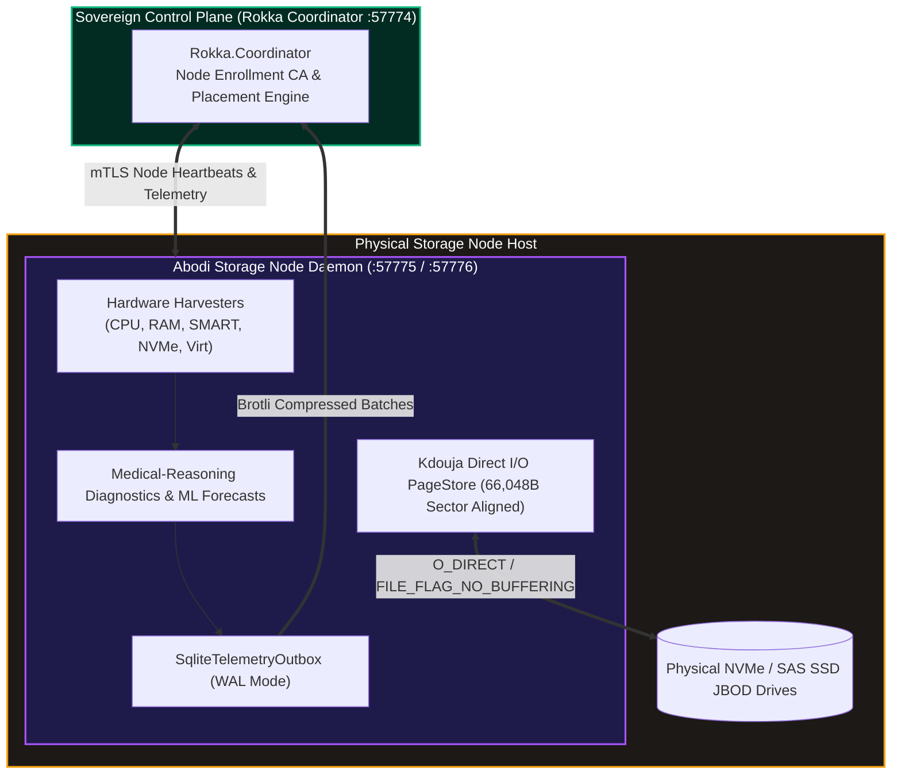

# Abodi Sovereign Storage & Hardware Diagnostics Node Daemon
# Official Production Air-Gapped Installation & Deployment Guide

| Specification | Details |
| :--- | :--- |
| **Document Identifier** | `ARK-DOC-ABODI-INSTALL-v1.0.1` |
| **Release Version** | `v1.0.1-GA (Production Stable)` |
| **Architectural Scope** | Physical Storage Node Daemon for **Aarkam - SAT (Standalone Tier: Rokka Substrate)** & **Aarkam - SCT (Storage Centers Tier: Aarkam.IO Cloud)** |
| **Target Audience** | Datacenter Storage Engineers, Infrastructure Administrators, Defense Systems Engineers |
| **Compliance Level** | Saudi NCA ECC-2:2024, NCA CSCC-1:2023, FIPS 140-3 Zero-Trust Architecture |
| **Target Distribution** | Zero-Egress Air-Gapped Datacenters (Linux x64, Windows Server x64) |

---

## 1. System Overview & Architecture

The **Abodi Sovereign Storage & Diagnostics Node Daemon** provides local hardware management, storage direct I/O, NVMe/SMART predictive maintenance, and zero-loss telemetry transport for physical nodes in an Aarkam deployment.

Abodi operates as the common substrate for both tiers of Aarkam:
- **Aarkam - SAT (Standalone Tier: Rokka Sovereign Engine)**: Exposes sector-aligned 66,048-byte physical page allocation via embedded Kdouja `PageStore`, enabling high-performance Cauchy Reed-Solomon erasure coding and hedged reads.
- **Aarkam - SCT (Storage Centers Tier: Aarkam.IO Sovereign Enterprise Cloud)**: Collects comprehensive hardware manifests, thermal telemetry, and failure predictions to maintain real-time cluster health.



---

## 2. Hardware & Operating System Requirements

### Supported Operating Systems
- **Linux (x86_64)**:
  - Red Hat Enterprise Linux (RHEL) 8.8+ / 9.2+
  - Rocky Linux 9.x / AlmaLinux 9.x
  - Ubuntu Server 22.04 LTS / 24.04 LTS
- **Windows (x64)**:
  - Windows Server 2022 / Windows Server 2025
  - Windows 11 Enterprise (workstation / edge testing)

### Hardware Requirements
- **CPU**: 4 Cores minimum (AVX2 supported for vector acceleration).
- **RAM**: 8 GB minimum (16 GB+ recommended for large NVMe page caching).
- **Storage**: Dedicated non-OS NVMe/SSD partition for Kdouja PageStore.
- **Network**: 1 GbE minimum; 10/25/100 GbE recommended for high-throughput Cauchy chunk replication.

---

## 3. Package Verification & Distribution Artifacts

The distribution packages in this directory contain single-file self-contained native binaries along with complete XML API documentation:

| Package File | Target Platform | Description |
| :--- | :--- | :--- |
| **`abodi-v1.0.1-linux-x64.zip`** | Linux x64 | Standalone `Abodi` native binary + XML docs + configuration + `install-abodi.sh` |
| **`abodi-v1.0.1-win-x64.zip`** | Windows x64 | Standalone `Abodi.exe` native binary + XML docs + configuration + `install-abodi.ps1` |

---

## 4. Linux Deployment (Automated systemd Installation)

1. **Extract Package**:
   ```bash
   sudo mkdir -p /opt/rokka/abodi
   sudo unzip abodi-v1.0.1-linux-x64.zip -d /opt/rokka/abodi
   sudo chmod +x /opt/rokka/abodi/Abodi /opt/rokka/abodi/install-abodi.sh
   ```

2. **Execute Automated Production Installer**:
   ```bash
   sudo /opt/rokka/abodi/install-abodi.sh \
     --node-code "NODE-LIN-01" \
     --rokka-url "https://rokka-coordinator.rokka.internal:57774" \
     --enrollment-token "ET1.YOUR_TOKEN_HEX" \
     --storage-dir "/var/lib/rokka/storage"
   ```

3. **Verify Service Operation**:
   ```bash
   sudo systemctl status rokka-abodi
   sudo journalctl -u rokka-abodi -f --lines 50
   ```

---

## 5. Windows Server Deployment (Automated Service Installation)

1. **Extract Package**:
   Extract `abodi-v1.0.1-win-x64.zip` to `C:\Rokka\Abodi`.

2. **Run Installer in Administrative PowerShell**:
   ```powershell
   Set-Location "C:\Rokka\Abodi"
   .\install-abodi.ps1 `
     -NodeCode "NODE-WIN-01" `
     -RokkaUrl "https://rokka-coordinator.rokka.internal:57774" `
     -EnrollmentToken "ET1.YOUR_TOKEN_HEX" `
     -StorageDir "D:\rokka_storage"
   ```

3. **Verify Service Operation**:
   ```powershell
   Get-Service -Name "Rokka.Abodi.Agent"
   Get-Content -Path "C:\Rokka\Abodi\logs\abodi-*.log" -Tail 50
   ```

---

## 6. Docker Container Deployment

Abodi is distributed as an enterprise-grade container image on Docker Hub with embedded hardware diagnostic tools (`smartmontools`, `nvme-cli`, `lm-sensors`, `iproute2`, `ethtool`):

### 6.1 Quick Run via Docker
```bash
docker run -d \
  --name rokka-abodi \
  --restart unless-stopped \
  --cap-add=SYS_RAWIO \
  --device=/dev/nvme0n1 \
  -v /var/lib/rokka/storage:/var/lib/rokka/storage \
  -v /var/lib/rokka/keys:/var/lib/rokka/keys \
  -p 57775:57775 \
  -p 57776:57776 \
  -e Node__NodeCode="NODE-DOCKER-01" \
  -e Rokka__CoordinatorUrl="https://rokka-coordinator.rokka.internal:57774" \
  aarkam/aarkam.abodi:v1.0.1
```

### 6.2 Docker Compose Deployment
```yaml
services:
  abodi:
    image: aarkam/aarkam.abodi:v1.0.1
    restart: unless-stopped
    cap_add:
      - SYS_RAWIO
    devices:
      - /dev/nvme0n1:/dev/nvme0n1:rwm
    volumes:
      - /var/lib/rokka/storage:/var/lib/rokka/storage
      - /var/lib/rokka/keys:/var/lib/rokka/keys
      - /var/log/rokka:/app/logs
    ports:
      - "57775:57775"
      - "57776:57776"
    environment:
      - ASPNETCORE_ENVIRONMENT=Production
      - Node__NodeCode=NODE-STORAGE-01
      - Rokka__CoordinatorUrl=https://rokka-coordinator.rokka.internal:57774

---

## 7. Network Port & Firewall Configuration

| Port | Protocol | Binding | Purpose |
| :---: | :---: | :---: | :--- |
| **`57775`** | gRPC (mTLS) | `0.0.0.0` | Node Storage Kdouja Direct I/O Chunk Data Service |
| **`7775`** | gRPC (Cleartext) | `127.0.0.1` | Local Intra-Node Storage gRPC Endpoint |
| **`57776`** | HTTPS / REST (mTLS) | `0.0.0.0` | Node Telemetry, Hardware Manifest & Control API |
| **`7776`** | HTTP / REST (Cleartext) | `127.0.0.1` | Local Host Diagnostic & Liveness Endpoint |
