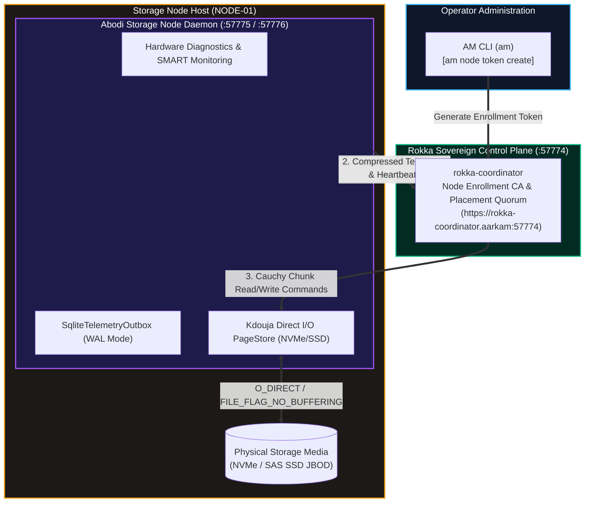

# Abodi Sovereign Storage & Hardware Diagnostics Node Daemon
# Official Production Air-Gapped Installation Guide (Version 1.0.2-GA)

| Specification | Details |
| :--- | :--- |
| **Document Identifier** | `ARK-ABODI-INSTALL-V1.0.2` |
| **Product** | Abodi Sovereign Storage Node Daemon (`Abodi` / `rokka-abodi`) |
| **Release Version** | `v1.0.2-GA (Production Stable)` |
| **Architectural Scope** | Physical Storage Node Agent & Hardware Telemetry Engine |
| **Target Audience** | Datacenter Storage Engineers, Infrastructure Administrators, Defense Systems Engineers |
| **Compliance Level** | Saudi NCA ECC-2:2024, NCA CSCC-1:2023, FIPS 140-3 Zero-Trust Architecture |
| **Target Distribution** | Zero-Egress Air-Gapped Datacenters (Linux x64, Windows Server x64, OCI Container) |

---

## 1. System Overview & Sovereign Ecosystem Role

The **Abodi Sovereign Storage & Diagnostics Node Daemon** is the physical storage node agent in the Aarkam ecosystem. Installed directly on each bare-metal or virtual storage host, Abodi executes direct NVMe/SSD block I/O via the embedded Kdouja `PageStore` kernel (enforcing exact 66,048-byte physical sector alignment for Cauchy Reed-Solomon erasure coding), monitors SMART/thermal telemetry, and streams health metrics exclusively to the **Rokka Storage Coordinator**.



### Key Integrations:
- **With Rokka (`rokka-coordinator`)**: Abodi enrolls via Coordinator's mTLS CA, acquires its cryptographically signed node certificate, reports capacity/telemetry, and serves Cauchy Reed-Solomon chunks to `rokka-gateway`.
- **With AM CLI (`am`)**: Operators generate node enrollment tokens via `am node token create`, inspect node inventory via `am node list`, and monitor physical drive health via `am node inspect`.

---

## 2. Standardized Endpoint Matrix

| Port | Protocol | Purpose | Access Scope |
| :--- | :--- | :--- | :--- |
| **`57775`** | gRPC / HTTP/2 (mTLS) | Kdouja Direct I/O Storage RPC & Chunk Transfer | Cluster Fabric (`rokka-gateway`, `rokka-coordinator`) |
| **`7775`** | HTTP/1.1 Cleartext | Storage Service Probe & Loopback Diagnostics | Local Host Only (`localhost`) |
| **`57776`** | HTTPS / REST (mTLS) | Diagnostic API, SMART Queries & Predictive ML Telemetry | Cluster Fabric (`rokka-coordinator`) |
| **`7776`** | HTTP/1.1 Cleartext | Telemetry Health Probe (`/health`) | Local Host Only (`localhost`) |

---

## 3. Prerequisites & NodeCode Identity Architecture

### Understanding NodeCode & Enrollment Tokens
In the Rokka sovereign storage fabric, each physical storage node has a unique, deterministic identifier called **`NodeCode`** (e.g. `NODE-01`, `STORAGE-RACK1-01`, or the machine hostname `$env:COMPUTERNAME`).

**How the Operator Gets & Uses NodeCode:**
1. **Choose an Identifier**: The datacenter administrator assigns a unique name for the physical server (or uses the machine's hostname).
2. **Issue Token via AM CLI**: From any administrative workstation running **AM CLI**, the operator requests a single-use cryptographically sealed enrollment token bound to that `NodeCode`:
   ```bash
   am node token create --node-code "NODE-01" --tier "SAT"
   ```
   *Take note of the returned token (e.g., `ET1.7a9f...`).*
3. **Pass to Installer**: When deploying Abodi on the physical server, provide both the assigned `-NodeCode "NODE-01"` and the `-EnrollmentToken "ET1.7a9f..."`.
   *(Note: If `-NodeCode` is omitted, the installer automatically defaults to the server's Windows hostname `$env:COMPUTERNAME`).*

---

## 4. Binary Package Download (GitHub Releases)

Official standalone binaries and air-gapped installation bundles are distributed via [GitHub Releases (v1.0.2)](https://github.com/aarkamio/Aarkam/releases/tag/v1.0.2).

| Platform | Package Asset | Download Link |
| :--- | :--- | :--- |
| **Linux (x64)** | `abodi-v1.0.2-linux-x64.zip` | [Download from GitHub](https://github.com/aarkamio/Aarkam/releases/download/v1.0.2/abodi-v1.0.2-linux-x64.zip) |
| **Windows (x64)** | `abodi-v1.0.2-win-x64.zip` | [Download from GitHub](https://github.com/aarkamio/Aarkam/releases/download/v1.0.2/abodi-v1.0.2-win-x64.zip) |

---

## 5. Linux Deployment (Automated systemd)

### Step 1: Download & Unpack Release Archive
```bash
sudo mkdir -p /opt/rokka/abodi
cd /opt/rokka/abodi
sudo curl -fSL -o abodi-v1.0.2-linux-x64.zip "https://github.com/aarkamio/Aarkam/releases/download/v1.0.2/abodi-v1.0.2-linux-x64.zip"
sudo unzip abodi-v1.0.2-linux-x64.zip
sudo chmod +x Abodi install-abodi.sh
```

### Step 2: Execute Automated Installer
```bash
sudo /opt/rokka/abodi/install-abodi.sh \
  --node-code "NODE-01" \
  --rokka-url "https://rokka-coordinator.aarkam:57774" \
  --enrollment-token "<YOUR_ENROLLMENT_TOKEN>" \
  --storage-dir "/var/lib/rokka/storage"
```

> [!TIP]
> **Flexible Sovereign URL Resolution**:
> - Default Sovereign FQDN: `--rokka-url "https://rokka-coordinator.aarkam:57774"`
> - Standard Port 443 (Reverse Proxy / Ingress): `--rokka-url "https://rokka-coordinator.aarkam"`
> - Custom On-Premises IP: `--rokka-url "https://10.20.0.10:57774"`
> - The installer automatically normalizes raw hostnames and ensures valid TLS configuration.

### Step 3: Verify Service Operation
```bash
sudo systemctl status rokka-abodi
curl -s http://localhost:7776/health
```

---

## 6. Windows Server Deployment (Automated PowerShell)

### Step 1: Download & Unpack Release Archive
Deploy Abodi binaries to the standardized enterprise location (`C:\Program Files\Aarkam\Abodi`):
```powershell
New-Item -ItemType Directory -Force -Path "C:\Program Files\Aarkam\Abodi"
Invoke-WebRequest -Uri "https://github.com/aarkamio/Aarkam/releases/download/v1.0.2/abodi-v1.0.2-win-x64.zip" -OutFile "C:\Program Files\Aarkam\Abodi\abodi-v1.0.2-win-x64.zip"
Expand-Archive -Path "C:\Program Files\Aarkam\Abodi\abodi-v1.0.2-win-x64.zip" -DestinationPath "C:\Program Files\Aarkam\Abodi" -Force
cd "C:\Program Files\Aarkam\Abodi"
```

### Step 2: Execute Automated Installer
Open PowerShell as **Administrator** and run:
```powershell
.\install-abodi.ps1 `
  -NodeCode "NODE-01" `
  -RokkaUrl "https://rokka-coordinator.aarkam:57774" `
  -EnrollmentToken "<YOUR_ENROLLMENT_TOKEN>" `
  -StorageDir "D:\Rokka\Storage" `
  -StartService
```

### Step 3: Verify Windows Service
```powershell
Get-Service -Name "Rokka.Abodi.Agent"
curl.exe -s http://localhost:7776/health
```

---

## 7. Docker Container Deployment

```bash
docker run -d \
  --name rokka-abodi \
  --restart unless-stopped \
  --cap-add=SYS_RAWIO \
  --device=/dev/nvme0n1 \
  -v /var/lib/rokka/storage:/var/lib/rokka/storage \
  -v /var/lib/rokka/keys:/var/lib/rokka/keys \
  -p 57775:57775 \
  -p 57776:57776 \
  -e Node__NodeCode="NODE-01" \
  -e Rokka__CoordinatorUrl="https://rokka-coordinator.aarkam:57774" \
  -e Rokka__EnrollmentToken="<YOUR_ENROLLMENT_TOKEN>" \
  aarkam/aarkam.abodi:v1.0.2
```

---

## 7. Cluster Verification via AM CLI

Once Abodi is running on your storage hosts, return to your administrative workstation with **AM CLI**:

1. **Verify Node Fleet Registration**:
   ```bash
   am node list
   ```

2. **Inspect Physical Drive Telemetry**:
   ```bash
   am node inspect --node-code "NODE-01"
   ```

3. **Verify S3 Object Storage End-to-End**:
   ```bash
   am s3 mb s3://validation-bucket --policy 4+2
   echo "Sovereign data integrity check" > test.txt
   am s3 cp test.txt s3://validation-bucket/test.txt
   am s3 cp s3://validation-bucket/test.txt downloaded.txt
   cat downloaded.txt
   ```
