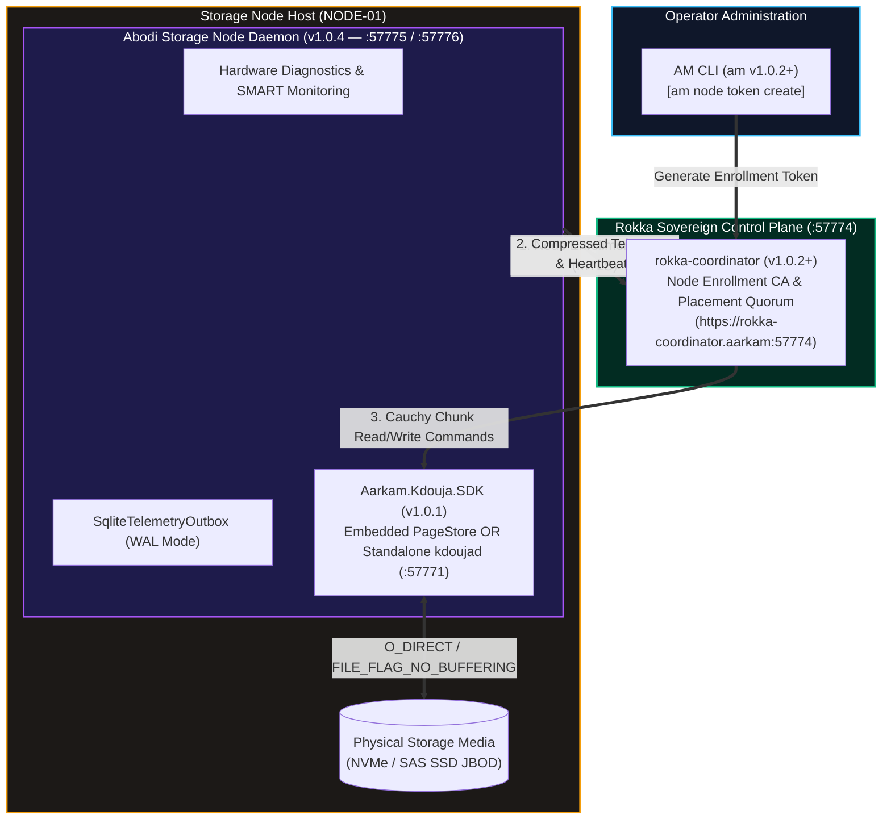

# Abodi Sovereign Storage & Hardware Diagnostics Node Daemon
# Official Production Air-Gapped Installation Guide (Version 1.0.4-GA)

| Specification | Details |
| :--- | :--- |
| **Document Identifier** | `ARK-ABODI-INSTALL-V1.0.4` |
| **Product** | Abodi Sovereign Storage Node Daemon (`Abodi` / Service: `Aarkam.Abodi`) |
| **Release Version** | `v1.0.4-GA (V-1.0.4, Production Stable)` |
| **Target Runtime** | `.NET 10.0` (Self-Contained Single-File Native Binaries & OCI Container) |
| **Architectural Scope** | Rokka-Native Storage Node Gateway, Dual-Mode Kdouja SAT Substrate & Hardware Telemetry Engine |
| **Target Audience** | Datacenter Storage Engineers, Infrastructure Administrators, Defense Systems Engineers |
| **Compliance Level** | Saudi NCA ECC-2:2024, NCA CSCC-1:2023, FIPS 140-3 Zero-Trust Architecture |
| **Target Distribution** | Zero-Egress Air-Gapped Datacenters (Linux `x86_64`, Windows Server `x64`, OCI Container) |

---

## 1. System Overview & Sovereign Ecosystem Role

The **Abodi Sovereign Storage & Diagnostics Node Daemon (`v1.0.4-GA`)** is the physical storage node agent in the Aarkam V2 ecosystem. Installed directly on each bare-metal or virtual storage host, Abodi bridges physical storage media (**Kdouja SAT** Direct I/O & LSM-Tree engine via **`Aarkam.Kdouja.SDK v1.0.1`**) with cluster-wide consensus and placement (**Rokka Storage Coordinator `v1.0.2+`**).



---

## 2. Valid Ecosystem Version Compatibility Matrix & Host Requirements

### 2.1 Validated Version Compatibility Matrix
| Component / Package | Required Version | Artifact / Package Identifier | Role |
| :--- | :---: | :--- | :--- |
| **Aarkam Abodi Daemon** | **`v1.0.4-GA` (`V-1.0.4`)** | `abodi-v1.0.4-win-x64.zip` / `abodi-v1.0.4-linux-x64.zip` / `aarkam/aarkam.abodi:v1.0.4` | Node Diagnostics, Telemetry, Zero-Trust mTLS Gateway & Placement Agent |
| **Aarkam Rokka Coordinator** | **`v1.0.2+`** | `Rokka.Common` / `Rokka.Contracts` / `Rokka.Client` `1.0.2` | Distributed Consensus Coordinator, Node CA (`:57774`), Placement & Erasure Coding |
| **Aarkam Kdouja SAT Daemon** | **`v1.0.2`** | `kdouja-v1.0.2-*` / `aarkam/aarkam.kdouja:v1.0.2` | Standalone LSM-Tree & Direct I/O Block Daemon (`kdoujad` on `:57771`) |
| **`Aarkam.Kdouja.SDK` Suite** | **`1.0.1`** | `Aarkam.Kdouja.SDK` (`+ .Embedded`, `.Remote`, `.AspNetCore`) | Unified .NET 10 SDK abstracting `Embedded` and `Standalone` Kdouja modes |
| **`Aarkam.Kdouja.Primitives`** | **`1.0.6`** | `Aarkam.Kdouja.Primitives` (`Aarkam.Kdouja.Engine 2.0.0`) | Zero-allocation Direct I/O buffers & CRC32 parity primitives |
| **Aarkam AM CLI** | **`v1.0.2+`** | `am-v1.0.2-win-x64.zip` / `am-v1.0.2-linux-x64.zip` | Operator CLI (`am node token create`, `am node list`, `am node inspect`) |
| **Aarkam Ahmodi Core** | **`1.0.1`** | `Aarkam.Ahmodi` / `Aarkam.Ahmodi.Abstractions` | Vectorized Cauchy Reed-Solomon erasure coding primitives |

### 2.2 Hardware & Operating System Requirements
| Requirement | Windows Server (`win-x64`) | Linux (`linux-x64`) |
| :--- | :--- | :--- |
| **Supported OS** | Windows Server 2022 (Build 20348+), Windows Server 2025 (Build 26100+), Windows 10/11 Enterprise/Pro x64 (Build 19044+) | Ubuntu 22.04 / 24.04 LTS, Debian 12+, RHEL / Rocky / AlmaLinux 9+ (Kernel `>= 5.15`, `glibc >= 2.34`) |
| **CPU Architecture** | 64-bit `x64` (`AMD64`) | 64-bit `x86_64` (`amd64`) |
| **Memory (RAM)** | `2,048 MB` minimum (`16,384 MB+` recommended for production) | `2,048 MB` minimum (`8,192 MB+` recommended for production) |
| **Runtime** | Self-contained in `Abodi.exe` (`.NET 10.0` bundled; zero external runtime required) | Self-contained in `Abodi` (`.NET 10.0` bundled; zero external runtime required) |
| **Hardware Subsystems** | WMI Storage Management (`root\Microsoft\Windows\Storage` / `MSFT_PhysicalDisk`), `w32time` service | `smartmontools` (`smartctl`), `nvme-cli` (`nvme`), `util-linux` (`lsblk`), `libcap2-bin` (`setcap`), `pciutils`, `dmidecode`, `lm-sensors`, `iproute2`, `ethtool`, `libsqlite3-0` |
| **Disk Space** | `>= 10 GB` free on Outbox volume (`C:\ProgramData\Rokka\Outbox`); dedicated non-`C:` data volume in production | `>= 10 GB` free on Outbox volume (`/var/lib/rokka/outbox`); dedicated non-root data volume in production |

---

## 3. Standardized Endpoint Matrix

| Port | Protocol | Purpose | Access Scope |
| :--- | :--- | :--- | :--- |
| **`57775`** | gRPC / HTTP/2 (mTLS) | Kdouja Direct I/O Storage RPC (`KdoujaStorageService` & `NodeHealthService`) | Cluster Fabric (`rokka-gateway`, `rokka-coordinator`) |
| **`7775`** | gRPC / HTTP/2 Cleartext | Local Intra-Host Storage Loopback & Write-Lock Gate | Local Host Only (`127.0.0.1`) |
| **`57776`** | HTTPS / REST (mTLS) | Diagnostic API, SMART Queries & Predictive ML Telemetry | Cluster Fabric (`rokka-coordinator`) |
| **`7776`** | HTTP / REST Cleartext | Local Liveness (`/api/v1/health/ping`) & Kdouja Health (`/healthz/kdouja`) | Local Host Only (`127.0.0.1`) |
| **`57771`** | gRPC / HTTP/2 | Standalone `kdoujad` Daemon (only when `Kdouja:Mode = "Standalone"`) | Local Loopback / Sidecar Only (`127.0.0.1`) |

---

## 4. Prerequisites & NodeCode Identity Architecture

In the Rokka sovereign storage fabric, each physical storage node has a unique identifier called **`NodeCode`** (e.g. `NODE-01`, `STORAGE-RACK1-01`, or the machine hostname) and authenticates using a SPIFFE X.509 certificate (`spiffe://aarkam.cluster/node/{NodeCode}`).

1. **Issue Single-Use Enrollment Token via AM CLI**:
   ```bash
   am node token create --node-code "NODE-01" --tier "SAT"
   ```
2. **Run Pre-Flight Check (Optional)**:
   - **Windows (PowerShell as Administrator):** `.\install-abodi.ps1 -CheckOnly`
   - **Linux:** `sudo ./install-abodi.sh --check-only`

---

## 5. Linux Deployment (Automated `systemd` — Service: `Aarkam.Abodi`)

### Step 1: Unpack Release Archive
```bash
sudo mkdir -p /opt/rokka/abodi
cd /opt/rokka/abodi
sudo unzip abodi-v1.0.4-linux-x64.zip -d /opt/rokka/abodi
sudo chmod +x /opt/rokka/abodi/Abodi /opt/rokka/abodi/install-abodi.sh
```

### Step 2: Execute Automated Installer
```bash
# Option A: Embedded Kdouja Mode (Default — In-Process Direct I/O PageStore)
# Omit --node-code to reuse appsettings.json or auto-generate a 15-char XXXX-XXXX-XXXXX code
sudo /opt/rokka/abodi/install-abodi.sh \
  --rokka-url "https://rokka-coordinator.aarkam:57774" \
  --enrollment-token "<YOUR_ENROLLMENT_TOKEN>" \
  --storage-dir "/mnt/nvme_data01/rokka_storage"

# Option B: Standalone Kdouja SAT Daemon Mode (Connects to local kdoujad v1.0.2 on :57771)
sudo /opt/rokka/abodi/install-abodi.sh \
  --rokka-url "https://rokka-coordinator.aarkam:57774" \
  --enrollment-token "<YOUR_ENROLLMENT_TOKEN>" \
  --storage-dir "/mnt/nvme_data01/rokka_storage" \
  --storage-mode Standalone \
  --kdouja-endpoint "http://127.0.0.1:57771"
```

### Step 3: Verify Service Operation
```bash
sudo systemctl status Aarkam.Abodi
curl -s http://127.0.0.1:7776/api/v1/health/ping
curl -s http://127.0.0.1:7776/healthz/kdouja
```

---

## 6. Windows Server Deployment (Automated PowerShell — Service: `Aarkam.Abodi`)

### Step 1: Unpack Release Archive
```powershell
Expand-Archive -Path .\abodi-v1.0.4-win-x64.zip -DestinationPath "C:\Program Files\Aarkam\Abodi" -Force
Set-Location "C:\Program Files\Aarkam\Abodi"
```

### Step 2: Execute Automated Installer
Open PowerShell as **Administrator** and run:
```powershell
# Option A: Embedded Kdouja Mode (Default)
# Omit -NodeCode to reuse appsettings.json or auto-generate a 15-char XXXX-XXXX-XXXXX code
.\install-abodi.ps1 `
  -RokkaUrl "https://rokka-coordinator.aarkam:57774" `
  -EnrollmentToken "<YOUR_ENROLLMENT_TOKEN>" `
  -StorageDir "D:\Rokka\Storage" `
  -StartService

# Option B: Standalone Kdouja SAT Mode (kdoujad.exe on :57771)
.\install-abodi.ps1 `
  -RokkaUrl "https://rokka-coordinator.aarkam:57774" `
  -EnrollmentToken "<YOUR_ENROLLMENT_TOKEN>" `
  -StorageDir "D:\Rokka\Storage" `
  -StorageMode "Standalone" `
  -KdoujaEndpoint "http://127.0.0.1:57771" `
  -StartService
```

### Step 3: Verify Windows Service
```powershell
Get-Service -Name "Aarkam.Abodi"
curl.exe -s http://127.0.0.1:7776/api/v1/health/ping
curl.exe -s http://127.0.0.1:7776/healthz/kdouja
```

---

## 7. Docker & Docker Compose Deployment

```bash
# Embedded Mode (Single Container — Default)
docker compose up -d

# Standalone Mode (Abodi v1.0.4 + kdoujad v1.0.2 Sidecar)
KDOUJA_MODE=Standalone docker compose --profile standalone up -d
```

---

## 8. Cluster Verification via AM CLI

1. **Verify Node Fleet Registration**:
   ```bash
   am node list
   ```
2. **Inspect Physical Drive Telemetry**:
   ```bash
   am node inspect --node-code "NODE-01"
   ```
